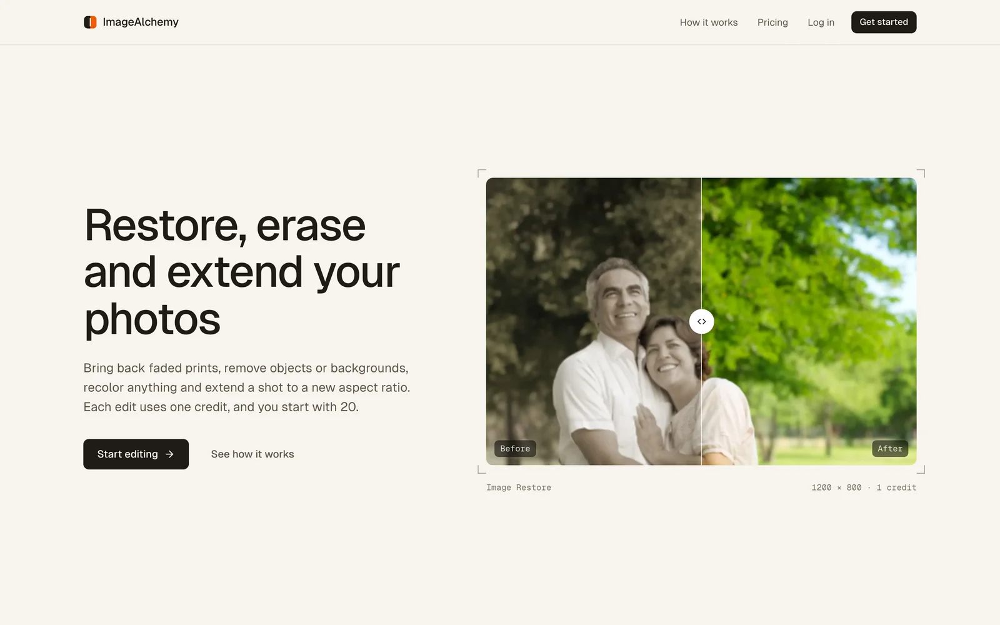
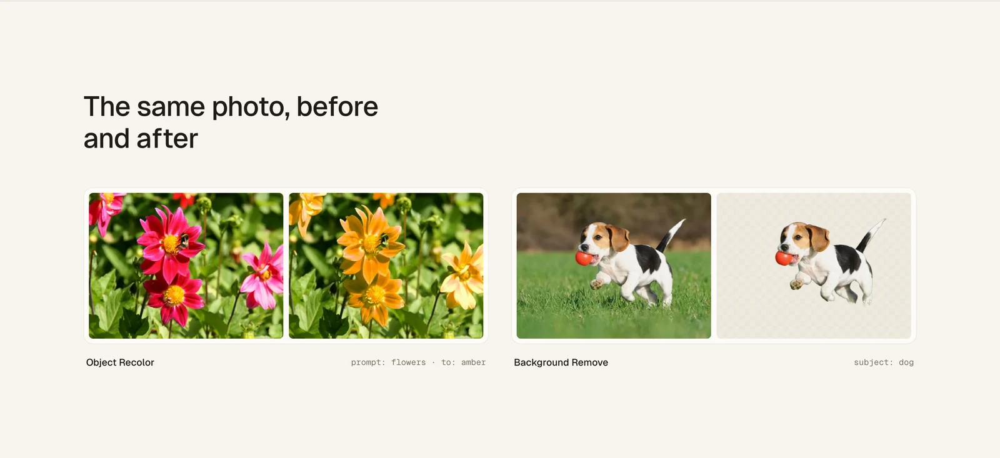
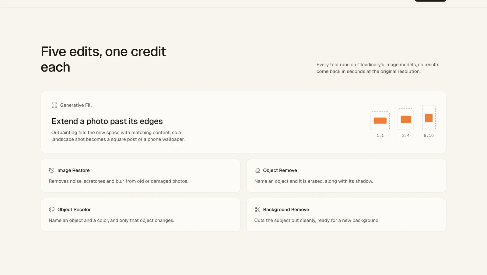

<div align="center">


# ImageAlchemy

Restore, erase and extend your photos in the browser.

[Live app](https://image-alchemy-sh.vercel.app/) · [How it works](#how-it-works) · [Run it locally](#run-it-locally)

</div>

<picture>
  <source media="(prefers-color-scheme: dark)" srcset="docs/screenshots/landing-dark.webp" />
  
</picture>

## What it does

ImageAlchemy is a photo editor built on Cloudinary's image models. Upload a photo, pick an edit, preview the result next to the original, then save it to your library or download it at full size. Every transformation costs one credit, and new accounts start with 20.

| Tool | What it does |
| --- | --- |
| **Image Restore** | Removes noise, scratches and blur from old or damaged photos |
| **Generative Fill** | Extends a photo to a new aspect ratio with outpainting: square (1:1), portrait (3:4) or phone (9:16) |
| **Object Remove** | Name an object and it is erased from the photo, along with its shadow |
| **Object Recolor** | Name an object and a color, and only that object changes |
| **Background Remove** | Cuts the subject out cleanly, ready for a new background |

<picture>
  <source media="(prefers-color-scheme: dark)" srcset="docs/screenshots/before-after-dark.webp" />
  
</picture>

> [!NOTE]
> The AI behind these tools is still experimental, so result quality varies. Image Restore works best on photos that are blurry or over-compressed.

## How it works

1. **Upload a photo.** It is stored on Cloudinary with your account.
2. **Choose an edit.** Fill in the settings for the tool (a prompt, a color or an aspect ratio) and apply it. Original and Result appear side by side.
3. **Save and download.** Saved edits land in your library on Home and Profile, where you can reopen, edit, download or delete them.

### Credits

Credits are bought as one-time packs through Stripe, with no subscription.

> [!IMPORTANT]
> This is a portfolio project, so Stripe runs in **test mode** and nothing is ever charged. To try checkout, use card `4242 4242 4242 4242` with any future expiry date and any CVC. The Credits page and the landing pricing section say the same.

| Plan | Price | Credits | Per credit |
| --- | --- | --- | --- |
| Free | $0 | 20 on sign-up | Free |
| Pro Package | $40 | 120 | $0.33 |
| Premium Package | $199 | 2,000 | $0.10 |

## Design

<picture>
  <source media="(prefers-color-scheme: dark)" srcset="docs/screenshots/features-dark.webp" />
  
</picture>

The UI is built around the idea of a photo darkroom and lightbox.

- **Light and dark themes.** The site follows the system setting by default, and a System / Light / Dark toggle in the sidebar, mobile menu and landing footer overrides it.
- **Neutral app, warm landing.** Inside the app, surfaces stay neutral grey in both themes so photo colors read true. The landing and auth pages use warm paper in light mode and a warm near-black in dark mode.
- **One accent.** Ember `#ED5E06` marks the primary action, the selection and key figures, and nothing else.
- **Type.** Geist for the interface and Geist Mono for figures and meta like `1 credit` or `1200 × 800`.
- **Signature detail.** Crop-corner marks frame photos wherever an image is shown.

All colors are CSS variables in [`app/globals.css`](app/globals.css), mapped to Tailwind in [`tailwind.config.ts`](tailwind.config.ts). Components use role names like `bg-surface`, `text-fg-2` and `border-border`, so a theme change never touches component code.

## Tech stack

| Area | Tools |
| --- | --- |
| Framework | Next.js 14 (App Router), React 18, TypeScript |
| UI | Tailwind CSS, Radix UI, Lucide icons, Geist, next-themes |
| Image processing | Cloudinary AI, next-cloudinary |
| Auth | Clerk |
| Database | MongoDB with Mongoose |
| Payments | Stripe |
| Forms | React Hook Form, Zod |

<details>
<summary>Architecture diagram</summary>


</details>

## Run it locally

Requires Node.js 26 (see `engines` in `package.json`).

```bash
git clone https://github.com/Stroller15/imagealchemy-ai.git
cd imagealchemy-ai
npm install
```

Create `.env.local` with these variables:

```bash
# MongoDB
MONGODB_URL=

# Clerk
NEXT_PUBLIC_CLERK_PUBLISHABLE_KEY=
CLERK_SECRET_KEY=
WEBHOOK_SECRET=
NEXT_PUBLIC_CLERK_SIGN_IN_URL=/sign-in
NEXT_PUBLIC_CLERK_SIGN_UP_URL=/sign-up
NEXT_PUBLIC_CLERK_AFTER_SIGN_IN_URL=/home
NEXT_PUBLIC_CLERK_AFTER_SIGN_UP_URL=/home

# Cloudinary
NEXT_PUBLIC_CLOUDINARY_CLOUD_NAME=
CLOUDINARY_API_KEY=
CLOUDINARY_API_SECRET=

# Stripe
NEXT_PUBLIC_STRIPE_PUBLISHABLE_KEY=
STRIPE_SECRET_KEY=
STRIPE_WEBHOOK_SECRET=
NEXT_PUBLIC_SERVER_URL=http://localhost:3000
```

If the project is linked to Vercel, `npx vercel env pull .env.local` fills these in for you.

Then start the dev server:

```bash
npm run dev
```

Open [http://localhost:3000](http://localhost:3000).

### Webhooks

- **Clerk → `/api/webhooks/clerk`** creates, updates and deletes the matching user in MongoDB. It needs `WEBHOOK_SECRET`. Accounts created before the webhook was connected have no database record, so sign up again after pointing the app at a new database.
- **Stripe → `/api/webhooks/stripe`** adds purchased credits to the buyer on `checkout.session.completed`. It needs `STRIPE_WEBHOOK_SECRET`. Create the webhook with Stripe's Test mode switch on, and use test keys (`pk_test_…`, `sk_test_…`) everywhere.

## Project structure

```
app/
  (marketing)/        Landing page
  (auth)/             Sign-in and sign-up, with the demo account panel
  (root)/             Signed-in app: home, editor, image details, profile, credits
  api/webhooks/       Clerk and Stripe webhooks
components/
  marketing/          Landing sections and the before/after slider
  shared/             App shell, editor, collection, plan cards, theme toggle
  ui/                 Radix-based primitives (button, input, select, dialog, toast)
constants/            Navigation, plans, transformation types, aspect ratios
lib/
  actions/            Server actions for images, users and transactions
  database/           Mongoose connection and models
```
